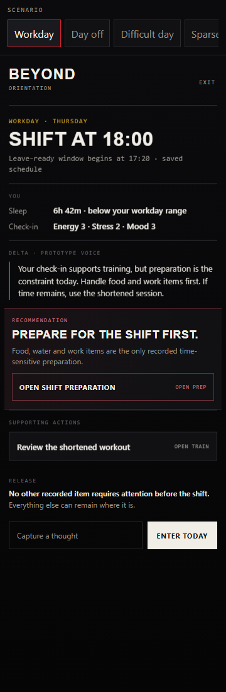
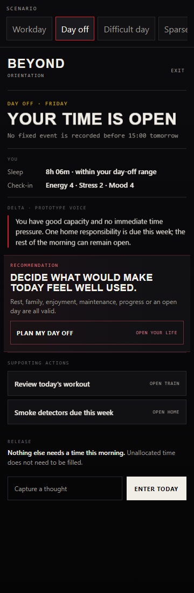

# BEYOND — Lived-Day Orientation prototype

Protected, non-production visual checkpoint for `LIVED-DAY-ORIENT-PROTOTYPE-001`.

## Open

Open `index.html` directly in a modern browser, or run the repository dev server and visit:

```text
http://localhost:5173/neo-beyond-lohnes/prototype/lived-day-orientation/
```

The prototype is one self-contained HTML file with no build step, dependency, network request,
provider, production import, or persistence. Refresh clears all interaction state.

## Review journey





1. Choose Workday and press START DAY. Review hierarchy, evidence, Delta voice, recommendation,
   supporting-action limit, release, immediate EXIT, ENTER TODAY, and reopen.
2. Compare Day off, Difficult day, Sparse, and Unknown states.
3. Resize or inspect at 320, 360, and 412 CSS pixels.
4. Judge whether it feels calm, capable, evidence-bounded, decisive, and respectful of open time.

## Boundaries

- This is not production UI and is not imported by `src/` or the production build.
- Buttons change page-memory presentation or show a prototype-only notice. They call no BEYOND command,
  write no data, persist nothing, and transmit nothing.
- Delta copy is deterministic sample copy. No model or provider is called.
- Sample recommendations illustrate the unresolved Protected composition decision. They are not Engine
  output and establish no runtime recommendation semantics or priority.
- Runtime identity remains BEYOND/Alfred. “Delta · prototype voice” previews the approved destination.
- No prototype decision authorizes implementation.

## Reuse

Reuses the repository's established standalone-prototype boundary and BEYOND's black/red/yellow
instrument language. The Orientation composition and interaction code are original to this objective.
No dependency or third-party asset was added.

## Verification

With the local dev server running on port 5174:

```text
node prototype/lived-day-orientation/verify.mjs
```

The verifier uses the repository's existing Playwright and axe-core dependencies. It checks all five
states at 320, 360, and 412 CSS pixels plus the desktop review shell, writes `verification.json`, and
refreshes the two preview images.
